# System Architecture & Workflow Locations

Sellbird is built as a privacy-first, zero-cloud sales automation platform. All machine learning, generation, and semantic vector operations execute strictly on the local workstation.

---

## 1. End-to-End System Architecture

The diagram below illustrates the complete data flow, highlighting the strict separation between the public web-research layer, the local database/task queue, and the air-gapped inference subsystem.

```mermaid
flowchart TD
    subgraph Client ["Client Layer (Local Browser)"]
        UI["Web Dashboard UI<br/>(Vanilla JS / SPA)<br/>sellbird/web/app.js"]
        CLI["CLI Commands<br/>sellbird/cli.py"]
    end

    subgraph Server ["API & Application Server (FastAPI / Uvicorn)"]
        API["FastAPI Endpoints<br/>sellbird/dashboard.py"]
        Worker["Background Task Queue Worker<br/>sellbird/tasks.py"]
    end

    subgraph DataLayer ["Local Storage & Cache (SQLite)"]
        DB[(Local SQLite DB<br/>data/sellbird.db)]
        T_Prospects["prospects & companies"]
        T_Products["products & icps"]
        T_Scores["scores & breakdown"]
        T_Outbox["outbox (drafts only)"]
        T_Tasks["tasks queue"]
        T_InferenceLog["inference_log"]
        T_Embeddings["embedding_cache"]
        DB --- T_Prospects
        DB --- T_Products
        DB --- T_Scores
        DB --- T_Outbox
        DB --- T_Tasks
        DB --- T_InferenceLog
        DB --- T_Embeddings
    end

    subgraph WebResearch ["Web Research Layer (Decoupled from AI)"]
        OSM["OpenStreetMap Discovery<br/>(Overpass API)"]
        ScoutCrawler["Scout HTTP Web Crawler<br/>(httpx / regex / bs4)"]
        Enricher["Contact Discovery<br/>sellbird/enricher.py"]
        Verifier["Deliverability Verifier<br/>sellbird/verifier.py"]
    end

    subgraph Workflows ["Core Sales Workflows (8 Services)"]
        W1["1. Business Profile<br/>sellbird/trainer.py"]
        W2["2. ICP Generation<br/>sellbird/trainer.py"]
        W3["3. Stored Research<br/>sellbird/stored_research.py"]
        W4["4. Buying Signals<br/>sellbird/buying_signals.py"]
        W5["5. Problem Statements<br/>sellbird/problem_statement.py"]
        W6["6. Email Drafting<br/>sellbird/email_drafter.py"]
        W7["7. Lead Scoring<br/>sellbird/scoring.py"]
        W8["8. Reply Classification<br/>sellbird/reply_classifier.py"]
    end

    subgraph LocalAI ["Local Air-Gapped AI Subsystem"]
        Brain["Brain Engine & Prompt Orchestration<br/>sellbird/brain.py"]
        OllamaClient["Ollama Client (httpx loopback)<br/>sellbird/ollama.py"]
        LocalOllama["Local Ollama Daemon<br/>http://localhost:11434<br/>(qwen3:1.7b / qwen3:4b)"]
        Embeddings["Local Embedding Model<br/>all-MiniLM-L6-v2<br/>(sentence-transformers)"]
    end

    %% Client Interactions
    UI <-->|HTTP / REST JSON| API
    CLI -->|Invokes| Workflows
    CLI -->|Starts| API

    %% API to Workflows and Queue
    API --> Workflows
    API --> Worker
    Worker --> Workflows

    %% Workflows with Storage
    Workflows <--> DB

    %% Web Research to Storage (Zero LLM)
    OSM -->|Populates raw prospects| DB
    ScoutCrawler -->|Stores raw website text| DB
    Enricher -->|Stores owner/manager names| DB
    Verifier -->|Validates MX / SMTP syntax| DB

    %% Workflows to Local AI
    W1 & W2 & W4 & W5 & W6 & W8 --> Brain
    W3 & W7 -->|Query / Cache Embeddings| Embeddings
    Embeddings <-->|Store/Retrieve Vectors| T_Embeddings
    W3 & W7 --> Brain
    
    Brain --> OllamaClient
    OllamaClient -->|Strict Loopback 127.0.0.1| LocalOllama
    Brain -->|Audit Log| T_InferenceLog

    %% Task Queue Fallback
    Workflows -.->|On Ollama Down / Queued| T_Tasks
    Worker <-->|Polls pending| T_Tasks
```

---

## 2. Decoupling Web Research from Inference

A core architectural principle of Sellbird is the absolute separation between data collection and LLM inference:

1. **Deterministic Web Research**:
   - The web discovery and crawling modules (`Scout`, `Enricher`, `Verifier`) use standard HTTP requests (`httpx`) to read public OpenStreetMap data and public company websites.
   - **No LLM is ever used to crawl, parse, or scrape websites.**
   - All extracted text is stored directly into the SQLite database as raw stored text.
2. **Offline-Only Stored Research**:
   - Workflow 3 (`stored_research.py`) builds prospect dossiers using **ONLY stored text** retrieved from SQLite.
   - It performs zero external network calls.
   - Local embeddings (`all-MiniLM-L6-v2`) retrieve relevant snippets from the stored text offline, and Ollama synthesizes the findings.

---

## 3. The 8 Sales Pipeline Workflows

The table below maps each of the 8 end-to-end sales workflows to its exact file location, entry functions, and fallback paths.

| # | Workflow Name | Source File | Key Functions | Execution Behavior & Fallback |
|---|---|---|---|---|
| **1** | **Business Profile** | `sellbird/trainer.py` | `Trainer.train`, `_extract_product_info` | Reads local product text or stored company pages; prompts Ollama for company profile and products. Pauses/queues if Ollama is unreachable. |
| **2** | **ICP Generation** | `sellbird/trainer.py`, `sellbird/dashboard.py` | `Trainer._extract_icp`, `POST /api/products/{id}/icp` | Takes product value proposition; generates target titles, company sizes, industries, and pain points via Ollama. |
| **3** | **Stored Research** | `sellbird/stored_research.py` | `build_research_summary`, `get_text_embedding` | Retrieves top-k snippets from stored prospect text via local `all-MiniLM-L6-v2` embeddings (cached in `embedding_cache`); LLM synthesizes summary, facts, events, and gaps. |
| **4** | **Buying Signals** | `sellbird/buying_signals.py` | `classify_buying_signals`, `detect_signals_regex` | Classifies stored text into 8 signal types with verbatim quote validation (quotes not present in text are dropped). Fallback: deterministic regex detector (`detect_signals_regex`, "non-LLM mode"). |
| **5** | **Problem Statements** | `sellbird/problem_statement.py` | `generate_problem_statement`, `_generate_deterministic_problem_statement` | Synthesizes product ICP + prospect research into 40-word problem statement and 25-word why-now. Fallback: deterministic template generator ("non-LLM mode"). |
| **6** | **Validated Email Drafting** | `sellbird/email_drafter.py` | `draft_validated_email`, `validate_email_draft` | Generates cold email drafts tailored to prospect + product + top signal. In-code validation (<110 words, mentions signal, 1 CTA, no hallucinated numbers). Auto-retries once; queues to SQLite `tasks` table on failure. Drafts only. |
| **7** | **Lead Scoring** | `sellbird/scoring.py` | `score_prospect_for_product`, `calculate_score_breakdown` | 100% deterministic score (0–100) combining ICP title match, industry, company size, buying signals, and cached embedding cosine similarity. LLM generates 40-word rationale. Fallback: rule-based rationale ("non-LLM mode"). |
| **8** | **Reply Classification** | `sellbird/reply_classifier.py` | `classify_reply`, `classify_reply_heuristic` | Classifies prospect replies into 8 categories (interested, objection, not_now, not_interested, unsubscribe, out_of_office, referral, unclear). Fallback: keyword heuristic ("non-LLM mode"). |

---

## 4. Database Schema & Tables

All persistence is contained in a single SQLite database file (`data/sellbird.db` or `data/offline_test.db` in test mode), managed by `sellbird/state.py`:

- `prospects`: Contact and prospect company profiles, stored text, and enrichment state.
- `companies`: Company metadata, domain, industry, size, and extracted signals.
- `products`: Product catalog, pricing, value propositions, and generated ICP JSON.
- `scores`: Product-specific prospect scores, breakdown JSON, and rationales.
- `outbox`: Draft email records with product binding, approval status (`draft`), and model name.
- `tasks`: Queue of deferred background jobs for execution when Ollama becomes available.
- `embedding_cache`: SHA256-keyed float vectors from `all-MiniLM-L6-v2` preventing redundant neural computation.
- `inference_log`: Complete audit trail of every Ollama inference call (timestamp, agent, task, model, host, latency, status).
